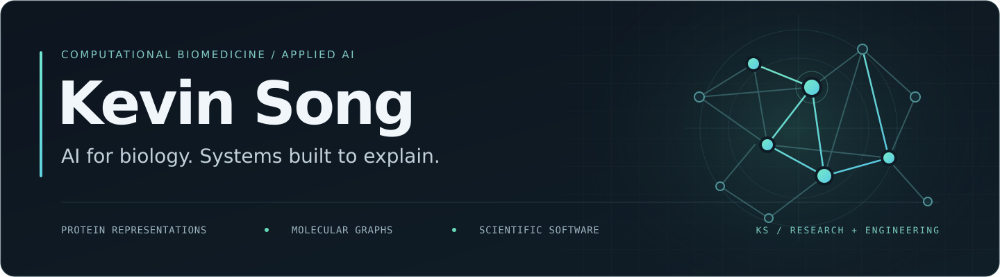

  

<h3 align="center">PhD Candidate · AI Developer · Computational Biomedical Engineer</h3>

  University of Alabama at Birmingham · Biomedical Engineering / Bioinformatics

  <a href="#selected-work">Selected work</a> &nbsp; / &nbsp;
  <a href="#research-directions">Research</a> &nbsp; / &nbsp;
  <a href="#technical-toolkit">Toolkit</a> &nbsp; / &nbsp;
  <a href="#how-i-build">Engineering philosophy</a>

---

I build **machine learning models and scientific software** for drug discovery, molecular interaction modeling, and cell-image analysis. My work connects **protein language models, molecular graphs, and network science** with the engineering needed to evaluate models and inspect their behavior.

The goal: turn biological questions into computational systems that produce **testable predictions and traceable results**.

## Selected work

<table>
  <tr>
    <td width="50%" valign="top">
      <h3><a href="https://github.com/kevinmsong/DeepDTA-iBAM">DeepDTA-iBAM</a></h3>
      
<strong>Learning across molecules and proteins.</strong>

      
Drug–target affinity modeling with molecular graphs, ESM-C protein embeddings, and bidirectional atom–residue cross-attention.

      
<code>PyTorch</code> <code>ESM-C</code> <code>RDKit</code>

      
<a href="https://github.com/kevinmsong/DeepDTA-iBAM">Explore the research →</a>

    </td>
    <td width="50%" valign="top">
      <h3><a href="https://github.com/kevinmsong/PharmacophoreCascade">PharmacophoreCascade</a></h3>
      
<strong>From peptide contacts to compound ranking.</strong>

      
Native peptide-contact pharmacophore screening, with benchmark data, analysis code, and a reference implementation for early screening stages.

      
<code>Cheminformatics</code> <code>Virtual screening</code>

      
<a href="https://github.com/kevinmsong/PharmacophoreCascade">Explore the research →</a>

    </td>
  </tr>
  <tr>
    <td width="50%" valign="top">
      <h3><a href="https://github.com/kevinmsong/CellScope">CellScope</a></h3>
      
<strong>Microscopy measurements you can trace.</strong>

      
Fluorescence image segmentation, cell-by-cell review, and morphology and nucleation measurements with documented analysis decisions.

      
<code>Cellpose</code> <code>Gradio</code> <code>Image analysis</code>

      
<a href="https://github.com/kevinmsong/CellScope">Explore the application →</a>

    </td>
    <td width="50%" valign="top">
      <h3><a href="https://github.com/kevinmsong/CryptoChaos">CryptoChaos</a></h3>
      
<strong>Cryptographic systems as a research problem.</strong>

      
Hybrid post-quantum encryption research combining ML-KEM-1024 and AES-256-GCM, with benchmark code and analysis data.

      
<code>Cryptography</code> <code>Benchmarking</code>

      
<a href="https://github.com/kevinmsong/CryptoChaos">Explore the research →</a>

    </td>
  </tr>
</table>

  <a href="https://github.com/kevinmsong?tab=repositories">Browse all repositories →</a>

## Research directions

- **AI for drug discovery:** molecular representations, affinity prediction, ligand retrieval, and interpretable screening workflows.
- **Cardiac regeneration:** computational screening and experimental evaluation of small molecules for cardiomyocyte proliferation.
- **Quantitative systems:** time-series modeling, strategy evaluation, and automation with explicit risk controls.

## Technical toolkit

| Area | Tools & methods | Application |
| :--- | :--- | :--- |
| **Scientific computing** | Python · NumPy · pandas · SciPy · scikit-learn | Data pipelines, numerical analysis, optimization |
| **Deep learning** | PyTorch · Hugging Face · ESM-C · cross-attention | Protein representations, multimodal learning, affinity prediction |
| **Molecular & systems biology** | RDKit · pharmacophores · STRING · COPASI · PySB | Molecular screening, interaction networks, biological modeling |
| **Research infrastructure** | Docker · GitHub Actions · TensorBoard | Reproducible environments, automation, experiment tracking |
| **APIs & applications** | FastAPI · Flask · Gradio · REST APIs | Research tools, model interfaces, integrated workflows |
| **Quantitative modeling** | Alpaca API · TA-Lib · pandas-ta | Time-series research, backtesting, risk analysis |
| **Visualization & reporting** | Matplotlib · Plotly · LaTeX | Diagnostic plots, scientific figures, technical communication |

## How I build

> “Architecture is intelligence made visible.”

- **Make assumptions visible.** Document what a model uses, what it predicts, and where its interpretation stops.
- **Evaluate the question that matters.** Choose baselines, data splits, and metrics that reflect the intended application.
- **Keep systems modular.** Separate data processing, models, evaluation, and interfaces so each can be inspected and improved.
- **Preserve the evidence.** Version configurations, track experiments, and keep the analysis behind the figures.

---

  Beyond code: chess · table tennis · martial arts · violin · black-and-white photography.

